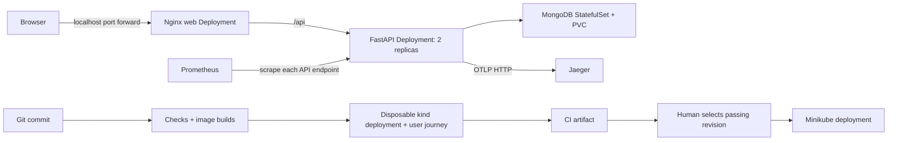

# Architecture and operation



## Choices and failure boundaries

- API and web are stateless Deployments. MongoDB is a single StatefulSet replica with a 1 GiB PVC. This demonstrates persistence, not database high availability. A database outage removes API readiness but leaves process liveness healthy; restarting the API cannot repair MongoDB.
- Two API replicas let a readiness-gated rolling update replace one process at a time. A single-node local cluster remains a single failure domain; node loss takes the whole demo down. No HPA is claimed because load and capacity targets have not been established.
- Separate non-root web/API images avoid supervisor and fix the baseline's missing supervisor configuration. The web image uses port 8080; the API uses 8001. Only a localhost port-forward exposes the app. MongoDB and observability services have no public LoadBalancer or NodePort.
- Kubernetes Secrets prevent values appearing in manifests; this is not a claim of encryption at rest. Pods do not mount service-account tokens. Web/API use read-only root filesystems, dropped capabilities, restricted privilege escalation and runtime-default seccomp. MongoDB needs writable database storage.
- MongoDB ingress policy permits only API pods on port 27017. Enforcement requires a NetworkPolicy-capable CNI. The default Minikube bridge/kind networking used in this demo does not establish enforcement; do not treat the policy as a tested firewall. Database authentication and internal-only exposure work independently.
- CI deploys to a disposable cluster and runs the real app. Production-style promotion is an explicit manual action because a hosted runner cannot reach the local cluster. GitOps and Terraform are optional in the brief and are not used.
- Python runtime dependencies are locked; the build uses the committed npm lockfile. Base images use version tags, not immutable digests; rebuilds may incorporate upstream patches. The resulting application images are identified by commit SHA.

## Signals and response

Prometheus scrapes each API pod through a headless metrics Service. A regular load-balanced Service would mix counter resets and hide replicas, so it is not used for scraping. Jaeger stores traces in memory and Prometheus uses an ephemeral 24-hour demo store. They are diagnostic tools, not durable evidence repositories; CI artifacts and recorded evidence are retained separately.

Targets for this local demonstration: under test load, at least 99% non-5xx responses and API p95 below 500 ms. These are proposed operational objectives, not a measured long-term SLA. Synthetic registration/login/task CRUD verifies actual user success; a 200 liveness response alone does not.

Useful PromQL:

```promql
sum(rate(teamtasks_http_requests_total[5m]))
sum(rate(teamtasks_http_requests_total{status=~"5.."}[5m])) / clamp_min(sum(rate(teamtasks_http_requests_total[5m])), 0.001)
histogram_quantile(0.95, sum by (le) (rate(teamtasks_http_request_duration_seconds_bucket[5m])))
up{job="teamtasks"}
```

Alert rules cover missing scrapes, >1% server errors and p95 >500 ms. They appear in Prometheus; no Alertmanager or external notification destination is configured. When an alert fires, identify the deployed SHA, inspect events/readiness and request logs, use a trace ID in Jaeger, then check MongoDB health and resource pressure. Compare with the previous release before rolling back. Verify recovery using both readiness and the authenticated smoke test.

## Controlled recovery exercise

Only in the disposable `teamtasks-devops` cluster:

1. Record current pods and run `scripts/smoke.py`.
2. Delete one API pod. The Deployment creates a replacement; wait for both replicas to become Ready and rerun the smoke test.
3. Optionally scale MongoDB to zero, observe `/api/ready` fail while `/api/health` succeeds, and restore it to one replica. Wait for API readiness and verify previously created data remains. This deliberately interrupts all app traffic.
4. Record the actual commands and outcomes; do not present a proposed exercise as executed evidence.

## Known limits

Local HTTP only; no TLS/Ingress or Internet-facing deployment. Single-node cluster and single MongoDB replica. No backup/restore automation. No proven NetworkPolicy enforcement. Metrics and traces are ephemeral; no external alert delivery. Frontend/browser dependency advisories and container-image vulnerabilities require ongoing triage; the automated blocking audit currently covers Python runtime dependencies. Existing application authorization logic has not undergone a comprehensive security audit. Google OAuth and native mobile builds are not verified. Smoke tests leave synthetic user accounts, so use a disposable database. Dependency upgrades retain some upstream deprecation warnings. No long-duration load or availability claim is made.

This change and its documentation were prepared with AI assistance. The course brief prohibits AI assistance; this PR must not be represented as independently authored work or used to make a false independent-work declaration.
